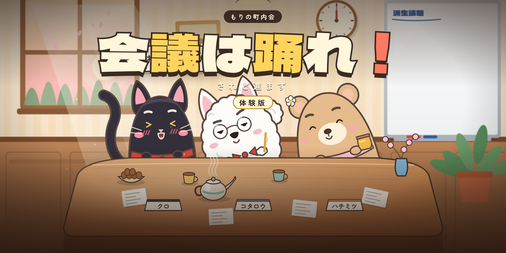

# 会議は踊れ！ 体験版

可愛い動物たちの会議が、脱線・増殖・暴走していくのを楽しむ、短時間で遊べるインクリメンタル・ローグライトです。ブラウザだけで遊べます。

**▶ 遊ぶ: https://aigamedev916.github.io/meeting-dances/**

あなたは「もりの町内会」の議長です。クロネコのクロ、サモエドのコタロウ、クマのハチミツの会議は勝手に進み、3匹は会議室じゅうを走り回ります。議長カードで脱線や反論をあおって議論ptを増やし、白熱しすぎて紛糾する前に採決しましょう。

- 1ランは会議3本（定例会 → 臨時会議 → 総会）で、約4〜5分です。
- ランの最初と会議の合間に「議事規則カード」を選びます。カードを掛け合わせると、点数が万・億・兆の桁で伸びていきます。
- ランが終わるともらえる議事録ページで「議事録棚」の品を買うと、次のランから会議が楽になります。

## 体験版で遊べるもの

- 春の議題3本：お花見の場所決め／新しいベンチを置こう／新入りさんの歓迎会
- 議事規則カード40枚
- 議事録棚の6品
- 表彰状18種、図鑑（見た掛け合い・決定事項・カード帳）
- 終えた会議の掛け合いの見返し

## 操作

| 操作 | キー / マウス |
|---|---|
| 台詞を送る | クリック / Space |
| 規則カードを選ぶ | 1〜4 / カードをクリック |
| 議長カード（脱線・反論・蒸し返し・整理） | 1〜4 / カードをクリック |
| 採決して会議を終える | Enter / ハンコをクリック |
| 議事録の画面を進める | Enter / ボタンをクリック |
| ハプニングを片付ける | 舞台の「!」をクリック |
| 休憩（一時停止・設定） | Esc / 歯車 |
| 掛け合いを見返す（議事録の画面） | R |

はじめての会議では、画面の各部を順に説明するチュートリアルが流れます。遊び方は、タイトル画面の「遊び方」からいつでも読めます。

## セーブ

進行状況は、お使いのブラウザ（localStorage）にだけ保存されます。サーバーには何も送りません。別のブラウザや端末とは共有されません。最初からやり直すときは、設定の「進行状況をリセット」を使います。

## 動作環境

PC やスマートフォンの最近のブラウザ（Chrome など）。

## ライセンス

このリポジトリにあるのは、公開用にビルドしたゲームのファイルだけです。使っているライブラリとフォントのライセンスは、[third-party-licenses.txt](https://aigamedev916.github.io/meeting-dances/third-party-licenses.txt) とゲームの設定画面の「ライセンス」にあります。

- GSAP（アニメーション）: GSAP Standard "No Charge" License
- Preact（画面の部品）: MIT License
- Zen Maru Gothic、Dela Gothic One（文字）: SIL Open Font License 1.1

ゲーム本体（絵・文章・プログラム）の著作権は作者にあります。無断での転載・再配布はご遠慮ください。
